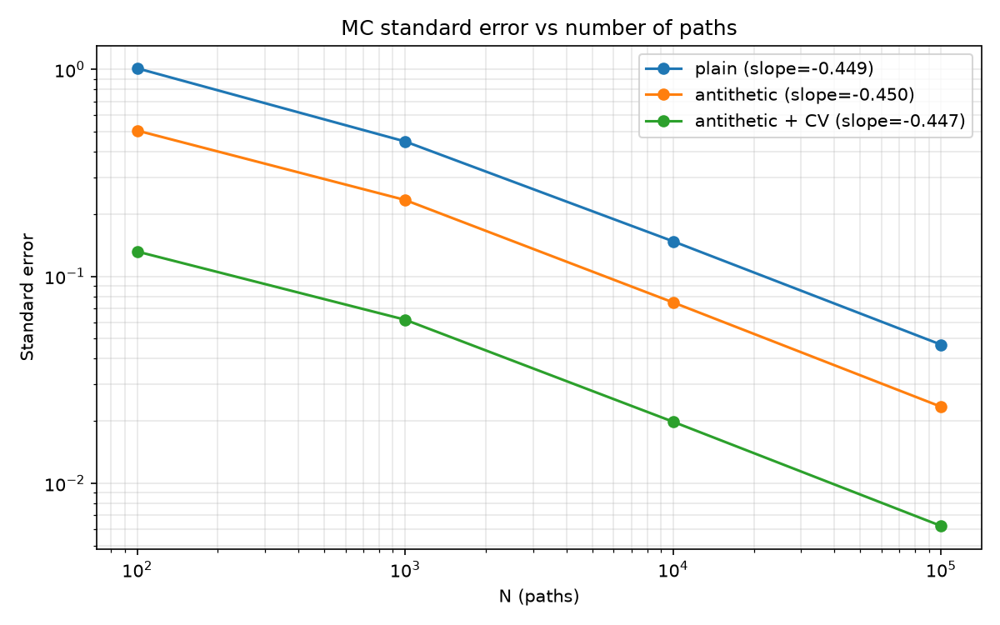
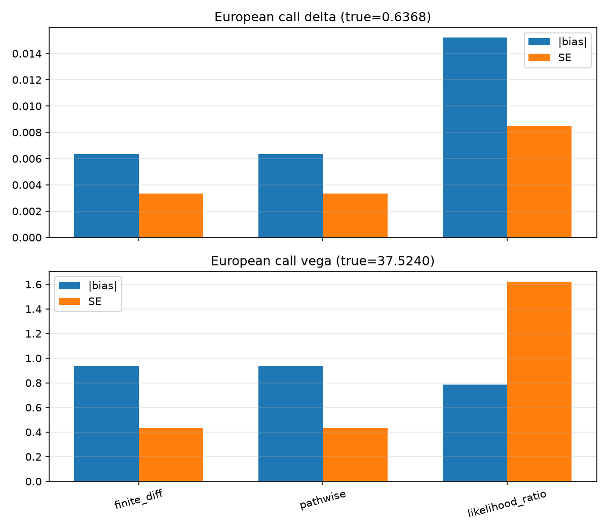
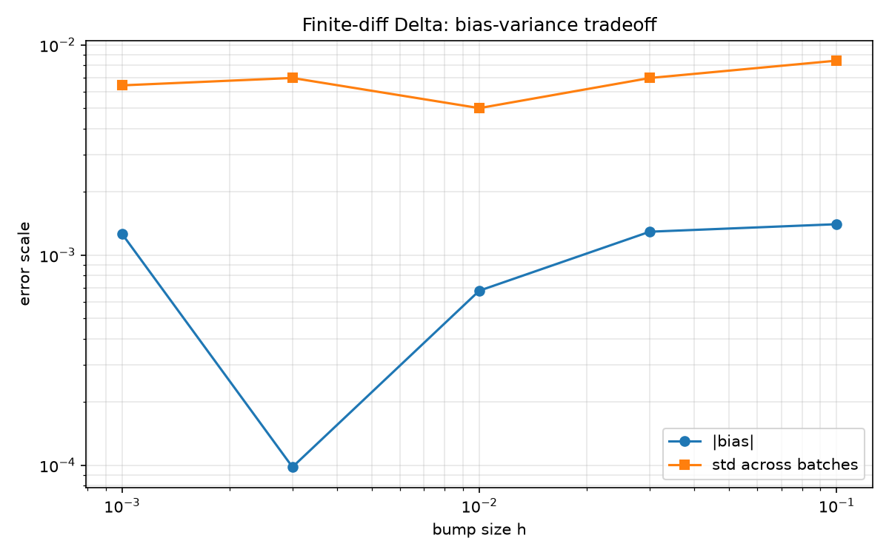
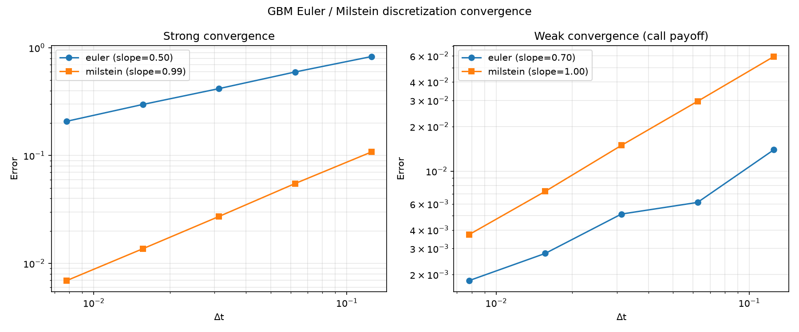
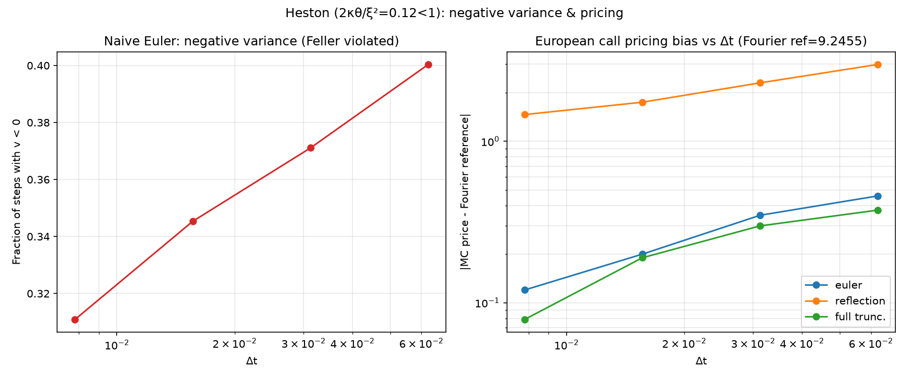
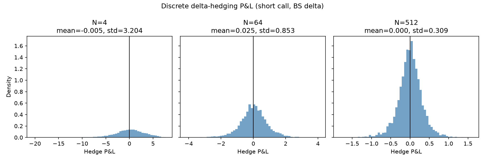
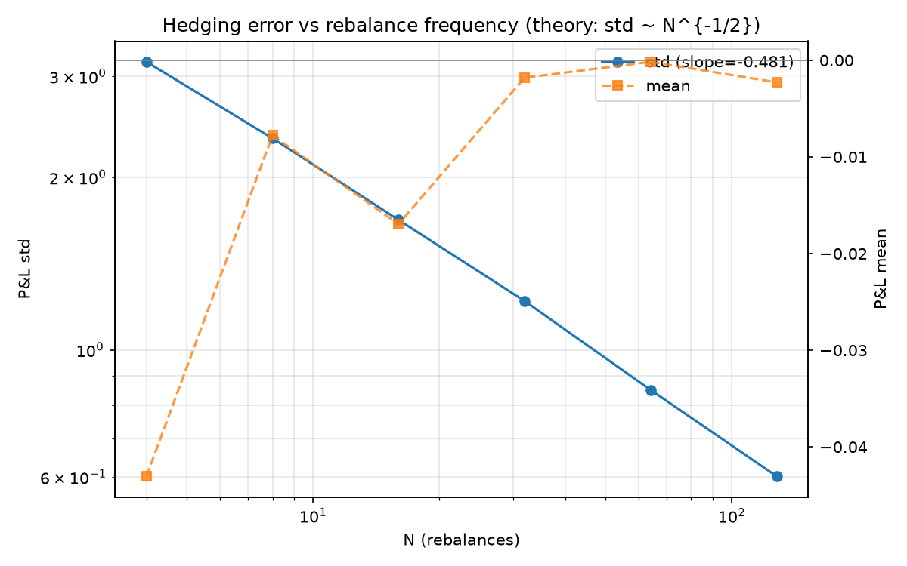
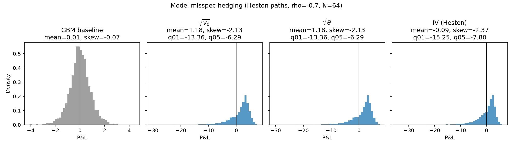
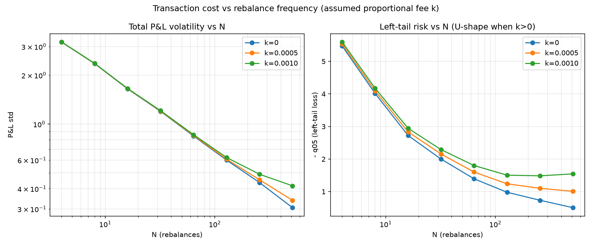

# 期权定价与对冲数值实验平台

**研究问题**：当真实世界不满足 Black-Scholes（BS）假设时，按 BS Delta 做对冲会产生多大误差？这个误差从哪里来，又如何随再平衡频率、波动率模型和交易成本变化？

本项目从零实现 BS 解析解、蒙特卡洛定价与 Greeks、SDE 离散化格式、Heston 模型（含半解析傅里叶定价）以及离散 Delta 对冲模拟。每一个数值结果都配有独立的对照（解析解、理论收敛阶、文献基准或另一种方法）。完整推导与讨论见 [技术报告](report/report.md)。

---

## 主要结论

1. **BS 世界里，离散对冲误差完全来自伊藤引理的二阶项。** P&L 标准差随再平衡次数 $N$ 按 $N^{-0.484}$ 衰减（理论 $-1/2$），$\text{std}\cdot\sqrt{N}\approx 6.4\sim 7.0$，与 Kamal-Derman 近似 $\sqrt{\pi/4}~\text{Vega}~\sigma=6.65$ 一致。把逐步的 $\tfrac{1}{2}\Gamma S^2\sigma^2(\Delta W^2-\Delta t)$ 累加，与实际 P&L 的相关系数达到 0.976（$N=32$）和 0.987（$N=128$）。
2. **模型误设带来的误差不能靠加密再平衡消除。** 真实路径为 Heston 时，$N$ 从 16 增加到 256，P&L 标准差只从 4.53 降到 3.94；同样条件下 GBM 世界从 1.68 降到 0.43。误差分布明显左偏（偏度 $-2.0\sim -3.1$）且厚尾（超额峰度 7~17）。
3. **P&L 均值由“收取的权利金是否公允”决定，且可以精确预测。** 风险中性下自融资交易收益的折现期望为 0，故 $\mathbb{E}[\text{PnL}]=e^{rT}\big(V_{BS}(\sigma_h)-C_{\text{Heston}}\big)$。三个 $\rho$、两种对冲波动率共六组实验，预测值与模拟值全部在约 1 个标准误内吻合（例如 $\rho=-0.7,\ \sigma_h=0.2$：预测 1.207，实测 $1.218\pm0.028$）。改用由傅里叶价格反推的隐含波动率 0.168 后，均值回到约 0，但 1% 分位数从 $-13.7$ 恶化到 $-16.0$：权利金公允了，尾部风险并没有减少。
4. **交易成本下存在最优再平衡频率，且大致与费率成反比。** 以 P&L 的 5% 分位数衡量左尾风险，$k=0.001$（0.1% 费率）时最优 $N=256$，$k=0.0005$（0.05% 费率）时在扫描范围内（至 512）仍单调下降。成本几乎只移动均值、不放大标准差，所以“标准差”这一指标看不到 U 形。
5. **Feller 条件不满足时，Heston 离散格式的选择对定价影响很大。** 在 $2\kappa\theta/\xi^2=0.125$ 的参数下，以傅里叶价格为基准、$\Delta t=1/32$ 时，reflection 格式偏差 2.19（74 个标准误），full truncation 偏差 0.147（7 个标准误）。

---

## 仓库结构

```
1005BS/
├── README.md
├── requirements.txt
├── pytest.ini
├── src/
│   ├── bs.py            # BS 解析价格与解析 Greeks
│   ├── mc_pricing.py    # 蒙特卡洛定价 + 对偶变量 / 控制变量
│   ├── mc_greeks.py     # 有限差分 / pathwise / 似然比三种 Greeks 方法
│   ├── processes.py     # GBM、Heston 路径；Euler / Milstein / full truncation；Heston 傅里叶定价
│   ├── hedging.py       # 离散 Delta 对冲、模型误设、交易成本
│   └── utils.py         # 随机数、标准误差、置信区间
├── tests/               # 45 项 pytest 验收测试
├── notebooks/
│   ├── 01_pricing_and_greeks.ipynb
│   ├── 02_discretization_convergence.ipynb
│   └── 03_hedging_experiments.ipynb
├── figures/             # 全部输出图片
└── report/report.md     # 技术报告
```

核心逻辑全部在 `src/`，notebook 只负责调用与画图。

---

## 图表与解读

除特别说明外，基准参数为 $S_0=K=100,\ T=1,\ r=0.05,\ \sigma=0.2$；Heston 参数为 $\kappa=1,\ \theta=0.04,\ \xi=0.8,\ \rho=-0.7,\ v_0=0.04$（Feller 条件不满足）。

### 实验一：蒙特卡洛定价与 Greeks



三种估计器的标准误差都按 $N^{-1/2}$ 衰减（基础 MC 拟合斜率 $-0.47$）。$10^5$ 个随机数下，对偶变量把方差降为 1/3.98，对偶加控制变量降为 1/56.4；1000 次重复实验中 95% 置信区间的覆盖率为 95.1%。



欧式看涨的 Delta 和 Vega 上，三种方法的偏差都在 2 个标准误以内。有限差分（公共随机数）与 pathwise 几乎重合；似然比法的标准误约为 pathwise 的 2.5~3.7 倍，这是它“不要求 payoff 光滑”的代价。



对欧式看涨，在公共随机数下有限差分的方差几乎不随步长 $h$ 变化（payoff 连续、Lipschitz），图中的“偏差”约 $10^{-3}$，小于批次间标准差，实质是 MC 噪声。真正的偏差-方差权衡出现在数字期权上：$h$ 从 0.1 缩到 0.01，标准误从 0.00065 放大到 0.0021（约 $\sqrt{10}$ 倍，对应方差 $\propto 1/h$）。

**数字期权**（payoff $\mathbf{1}_{\\{S_T>K\\}}$，真值 Delta = 0.018762）：pathwise 估计恒为 0，完全失效；似然比给出 $0.018765\pm0.000062$；有限差分（$h=0.01$）给出 $0.0185\pm0.0021$，方差约为似然比的 1100 倍。

### 实验二：离散化格式



强收敛阶：Euler 0.49，Milstein 0.98，与理论值 0.5 和 1.0 吻合。弱收敛（看涨 payoff）Milstein 斜率 0.99；Euler 在细步长下误差已降到 $10^{-4}$ 量级、接近 MC 分辨率，拟合斜率对样本敏感（6 万条路径时 1.28，测试用的 2.5 万条路径时 0.70），不宜过度解读。



左图：朴素 Euler 下方差为负的步数占比从 42.6%（$\Delta t=1/8$）只缓慢降到 28.4%（$\Delta t=1/256$），因为 Feller 比值仅 0.125。右图：以 Heston 傅里叶半解析价格 9.2455 为基准，reflection 格式的偏差最大且收敛最慢；full truncation 与只在扩散项截断的 Euler 偏差相近，$\Delta t\le 1/64$ 后降到 MC 噪声水平。

### 实验三：GBM 下的离散 Delta 对冲



卖出一份平值看涨并用 BS Delta 对冲（风险中性漂移，每个 $N$ 2 万条路径）。随 $N$ 增大，P&L 分布向 0 收缩，均值始终在约 2 个标准误以内。



P&L 标准差的 log-log 斜率为 $-0.484$。用真实漂移 $\mu=0.12$ 模拟（$N=64$），均值为 $-0.004\pm0.006$，与风险中性下没有可检测的差别：Delta 对冲已经消去了一阶的漂移暴露。

### 实验四：模型误设与交易成本



真实路径用 Heston 生成，对冲者使用 BS Delta。与左侧 GBM 基准（std 0.86，近似对称）相比，Heston 世界的 P&L 标准差约为 4，左尾长得多。注意：默认参数 $v_0=\theta$，所以图中 $\sqrt{v_0}$ 与 $\sqrt{\theta}$ 两组完全相同。



左图：标准差随 $N$ 单调下降，成本只让曲线在高频段略微抬升。右图：左尾损失 $-q_{05}$ 在 $k=0.001$ 时于 $N=256$ 处最小（1.48），之后回升，呈 U 形。费率 $k$ 为假设值，不对应任何特定市场。

---

## 复现

**环境**：Python 3.13（3.10+ 均可），numpy 2.5、scipy 1.18、matplotlib 3.11、pytest。

```powershell
python -m venv .venv
.\.venv\Scripts\pip install -r requirements.txt
.\.venv\Scripts\pytest -q
```

**随机种子**：全局默认种子为 `src/utils.py` 中的 `DEFAULT_SEED = 42`，所有实验函数都接受 `seed` 参数。

**图表**：

- 运行 `pytest` 会重新生成全部 9 张图，但为了速度使用较小样本（5 千到 3 万条路径）。
- 报告与本页使用的数字来自各绘图函数的默认参数（2 万到 10 万条路径），按顺序运行 `notebooks/01_pricing_and_greeks.ipynb`、`02_discretization_convergence.ipynb`、`03_hedging_experiments.ipynb` 即可复现实验一至实验四的全部图表。

---

## 局限性

- 参数均为假设值，没有校准到真实市场的期权数据；利率为常数，没有股息。
- 模型误设实验默认 $v_0=\theta$，使 $\sqrt{v_0}$ 与 $\sqrt{\theta}$ 两种对冲波动率相同，未能区分“初始波动率”与“长期波动率”的影响。
- Heston 路径用 full truncation 离散。$\Delta t=1/32$ 时定价偏差 0.147 仍显著；对冲实验中 $N=64$（$\Delta t=1/64$）的离散偏差已低于 MC 分辨率，但没有单独精确测量。没有实现 QE 格式。
- `hedging.plot_cost_tradeoff` 返回的“最优 N”用的是 $-q_{05}+0.2\cdot\text{std}$ 的启发式指标，权重 0.2 没有理论依据；正文中的最优频率直接按 $-q_{05}$ 的最小值读取。
